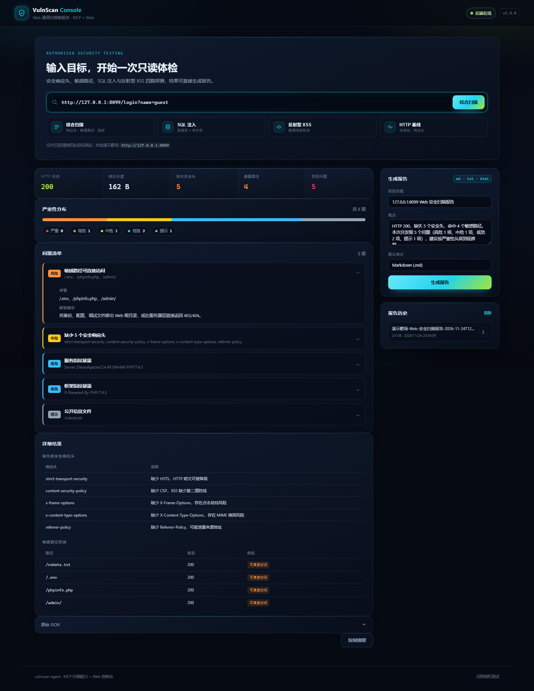

# vulnscan-agent

面向 AI 编码智能体（pi / Claude 等）的 **Web 漏洞扫描能力包**：一套零第三方依赖的扫描核心，同时提供 **MCP 工具** 与 **图形化 Web 控制台**。

> 仅用于**获得授权的**安全测试与教学靶场。所有探测均为只读请求，不包含写操作、脱库或提权逻辑。



## 功能特性

- **四条只读探测链路**
  - `scan_web`：状态码、标题、服务/框架指纹、缺失的安全响应头、Cookie 属性、常见敏感路径（`.git`、`.env`、`phpinfo` 等）
  - `http_probe`：单 URL 基线（状态码、标题、长度、全部响应头）
  - `test_sqli`：报错型 + 布尔型的 GET 参数 SQL 注入检测
  - `test_xss`：反射型 XSS 载荷回显检测
- **误报控制**：内置软 404 识别（对「任意路径都返回 200」的服务器做响应体基线对比）；`robots.txt` 仅作为信息提示
- **自动修复建议**：按问题类型内置整改建议，报告中直接可读
- **报告生成**：Markdown / 纯文本 / HTML 三种格式，漏洞按严重性自动排序
- **图形化控制台**：暗色安全控制台风格，一键扫描、严重性分布、证据展开、报告生成与历史管理
- **零第三方依赖**：只用 Node.js 内置模块（`node:http`、`fetch`、`readline`），无需 `npm install`
- **双入口一致**：MCP 服务与 Web 后端共用同一套扫描核心，行为完全一致

## 架构

```text
                    ┌────────────────────────────┐
                    │  pi / AI Agent (MCP 客户端) │
                    └─────────────┬──────────────┘
                          stdio JSON-RPC 2.0
                    ┌─────────────┴──────────────┐
                    │  mcp/vulnscan.mjs          │
                    │  mcp/report.mjs            │
                    └─────────────┬──────────────┘
                                  │
  浏览器 ── HTTP ──► web/server.mjs ──► src/scanner.mjs ──► 目标站点（只读）
                    │                └► src/reporter.mjs ──► reports/*.md
                    └── 静态页面 web/public/*
```

## 目录结构

```text
vulnscan-agent/
├─ src/
│  ├─ scanner.mjs      # 扫描核心：安全头、敏感路径、SQLi、XSS
│  ├─ reporter.mjs     # 报告渲染：md / txt / html
│  └─ mcp.mjs          # 极简 MCP stdio 传输层
├─ mcp/
│  ├─ vulnscan.mjs     # 漏洞扫描 MCP 服务
│  └─ report.mjs       # 报告生成 MCP 服务
├─ web/
│  ├─ server.mjs       # 零依赖 HTTP 服务：API + 静态托管
│  └─ public/          # 图形化控制台（原生 HTML/CSS/JS）
├─ demo/
│  └─ vulnerable-target.mjs  # 本地故意脆弱靶场，用于验证检测能力
├─ docs/               # 截图
├─ package.json
└─ README.md
```

## 快速开始

要求：**Node.js >= 20**（使用内置 `fetch` 与 `AbortSignal.timeout`）。

```bash
git clone https://github.com/chenke0820/vulnscan-agent.git
cd vulnscan-agent
```

### 1. 启动本地演示靶场（可选，用于体验）

```bash
npm run demo
# 演示靶场: http://127.0.0.1:8099
# XSS 入口: http://127.0.0.1:8099/login?name=guest
# SQLi 入口: http://127.0.0.1:8099/item?id=1
```

> 该靶场是**故意脆弱**的本地服务，请勿部署到公网。

### 2. 启动图形化控制台

```bash
npm run web
# 打开 http://127.0.0.1:7788
```

在输入框中填入目标（例如 `http://127.0.0.1:8099/login?name=guest`），选择「综合扫描 / SQL 注入 / 反射型 XSS / HTTP 基线」，右侧可直接生成并下载报告。

环境变量：

| 变量 | 默认值 | 说明 |
| --- | --- | --- |
| `HOST` | `127.0.0.1` | 监听地址；仅本机访问更安全 |
| `PORT` | `7788` | 监听端口 |
| `REPORTS_DIR` | `<repo>/reports` | 报告输出目录 |

### 3. 作为 MCP 工具接入 pi

```bash
npm run mcp:vulnscan   # stdio MCP：scan_web / http_probe / test_sqli / test_xss
npm run mcp:report     # stdio MCP：create_report / append_section / list_reports / read_report
```

在 `~/.pi/agent/mcp.json` 中注册（路径按实际克隆位置修改）：

```json
{
  "mcpServers": {
    "vulnscan": {
      "command": "node",
      "args": ["<绝对路径>/vulnscan-agent/mcp/vulnscan.mjs"],
      "exposure": "direct",
      "description": "Web 漏洞扫描：安全响应头、敏感路径、SQL 注入、反射型 XSS",
      "timeout": 120
    },
    "report": {
      "command": "node",
      "args": ["<绝对路径>/vulnscan-agent/mcp/report.mjs"],
      "exposure": "direct",
      "description": "报告编写：生成 Markdown / 纯文本 / HTML 报告",
      "env": { "PI_REPORT_DIR": "<绝对路径>/vulnscan-agent/reports" },
      "timeout": 120
    }
  }
}
```

接入后可直接对智能体说：

```text
调用 mcp 扫描 http://127.0.0.1:8099/login?name=guest，
分析哪些是真漏洞、哪些是误报，说明严重程度与危害，
最后调用 create_report 生成 Markdown 报告。
```

## MCP 工具

| 工具 | 参数 | 说明 |
| --- | --- | --- |
| `scan_web` | `url`、`paths?` | 基础安全检查：状态、指纹、安全头、Cookie、敏感路径 |
| `http_probe` | `url` | 单 URL 基线与完整响应头 |
| `test_sqli` | `url`、`param?` | 报错型 + 布尔型 SQL 注入检测，`param` 默认取 URL 最后一个参数 |
| `test_xss` | `url`、`param?`、`payload?` | 反射型 XSS 检测，默认载荷 `` |
| `create_report` | `title`、`target`、`summary`、`findings`、`format?` | 生成报告，支持 `md` / `txt` / `html` |
| `append_section` | `file`、`heading`、`body` | 向已有 Markdown 报告追加章节 |
| `list_reports` | — | 按修改时间倒序列出报告 |
| `read_report` | `file` | 读取报告内容（最多 20000 字符） |

## HTTP API

成功返回 `{ "ok": true, "data": ... }`，失败返回 `{ "ok": false, "error": "..." }`。

| 方法 | 路径 | 请求体 | 说明 |
| --- | --- | --- | --- |
| GET | `/api/health` | — | 服务状态、工具列表、报告数量 |
| POST | `/api/scan` | `{ url, paths? }` | 综合扫描 |
| POST | `/api/probe` | `{ url }` | HTTP 基线探测 |
| POST | `/api/sqli` | `{ url, param? }` | SQL 注入检测 |
| POST | `/api/xss` | `{ url, param?, payload? }` | 反射型 XSS 检测 |
| POST | `/api/report` | `{ title, target, summary, findings, format }` | 生成报告 |
| GET | `/api/reports` | — | 报告列表 |
| GET | `/api/reports/<name>` | — | 读取报告内容 |
| GET | `/api/reports/<name>?download=1` | — | 下载报告 |

示例：

```bash
curl -X POST http://127.0.0.1:7788/api/sqli \
  -H "Content-Type: application/json" \
  -d '{"url":"http://127.0.0.1:8099/item?id=1"}'
```

## 报告

`reports/` 下会生成 Markdown 报告，结构为「概述 → 漏洞清单（按严重性排序）→ 结论 → 附加章节」，包含证据与修复建议。生成的示例见 [docs/sample-report.md](docs/sample-report.md)。

```markdown
| 序号 | 严重性 | 漏洞名称 | 证据 | 修复建议 |
| --- | --- | --- | --- | --- |
| 1 | 严重 | SQL 注入（报错型） | ... MySQL syntax error ... | 使用参数化查询/预编译语句... |
```

## 检测能力与局限

- **SQL 注入**：基于报错特征与 `and 1=1 / and 1=2` 的响应长度差异，适合 GET 参数；不覆盖时间盲注、POST 注入、二次注入。
- **XSS**：仅覆盖反射型，且要求载荷原样回显；不覆盖存储型与 DOM 型。
- **敏感路径**：内置软 404 判定，仍可能受自定义错误页影响，建议人工复核。
- **安全头**：HSTS 只在 HTTPS 场景有意义，纯 HTTP 靶场中该提示可按环境降级。
- 自动化扫描无法替代人工测试，报告结论应结合业务上下文复核。

## 开发与验证

```bash
# 语法检查
node --check src/scanner.mjs
node --check web/server.mjs
node --check web/public/app.js

# 手工验证 MCP（stdio，一行一条 JSON-RPC）
echo '{"jsonrpc":"2.0","id":1,"method":"tools/list"}' | node mcp/vulnscan.mjs
```

## 安全声明

- 仅对**你拥有或已获得书面授权**的目标进行扫描。
- 默认只监听 `127.0.0.1`，请勿将本服务直接暴露到公网。
- 报告目录之外的路径读写会被拒绝（路径穿越防护）。
- `demo/vulnerable-target.mjs` 包含故意漏洞，仅限本地教学使用。

## License

[MIT](LICENSE)
